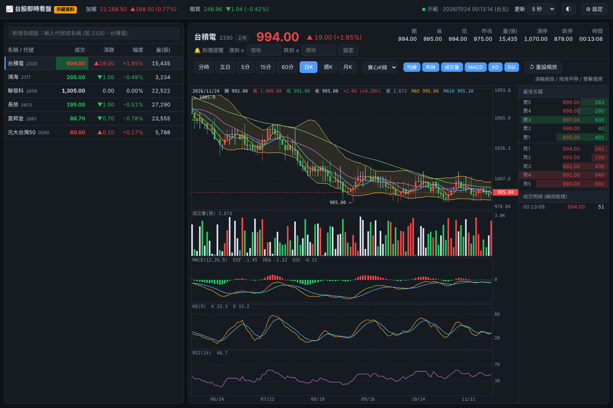
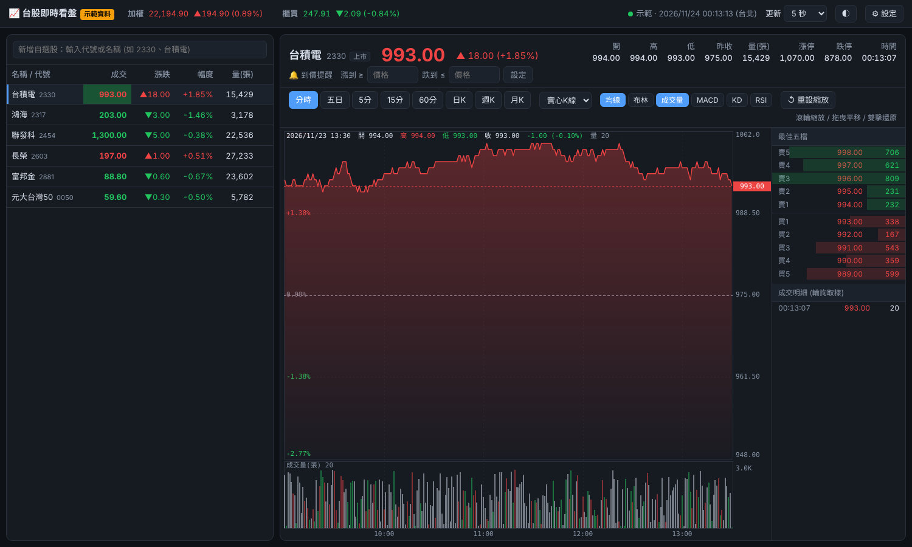

# 📈 台股即時看盤 (Taiwan Stock Monitor)

在本機執行的台股即時看盤程式：自選股報價、最佳五檔、多週期 K 線與技術指標，圖表屬性都能自行設定。
**只需 Python 3.8+，不用安裝任何套件**（永豐 API 為選用）。




> 截圖使用 `--demo` 的假資料，非真實行情。

## 功能

- **即時報價**：上市、上櫃、ETF 與加權／櫃買指數；漲停跌停標示、價格變動閃爍、紅漲綠跌（可切換美股配色）
- **最佳五檔 + 成交明細**
- **多週期線圖**：分時、五日、5 / 15 / 60 分、日 K、週 K、月 K
- **圖表屬性可自訂**（右上角「⚙ 設定」，即時生效並自動儲存於瀏覽器）
  - 類型：實心 K、空心 K、美國線、線圖、面積圖
  - 外觀：線寬、顏色、K 棒寬度、預設根數、格線、十字游標、資訊列、現價線、高低點標記、對數座標
  - 指標：MA ×4、EMA ×2、布林通道、成交量、MACD、KD、RSI（週期與顏色皆可調）
- **自選股**：代號或名稱搜尋、欄位自選、到價提醒（通知 + 音效）
- 滾輪縮放、拖曳平移、雙擊還原；亮 / 暗色主題

## 快速開始

```bash
git clone https://github.com/<你的帳號>/<repo名稱>.git
cd <repo名稱>
python3 main.py            # 會自動開啟 http://127.0.0.1:8765
python3 main.py --demo     # 離線示範模式（假資料）
```

常用參數：

| 參數 | 說明 |
|---|---|
| `--port 8765` | 伺服器埠號 |
| `--demo` | 示範模式，不連網 |
| `--source auto\|mis\|sinopac` | 資料來源，預設 `auto` |
| `--no-browser` | 不自動開啟瀏覽器 |
| `--insecure` | 略過 SSL 憑證驗證（僅在 macOS 憑證問題時使用） |

## 資料來源

| 用途 | 預設 | 選用：永豐 Shioaji |
|---|---|---|
| 即時報價 / 五檔 | 證交所 MIS（約每數秒輪詢） | WebSocket 推送 |
| 分鐘 K 線 | Yahoo Finance | `api.kbars` |
| 日 / 週 / 月 K | Yahoo Finance → 證交所備援（僅上市） | 最後備援 |
| 指數 | 證交所 MIS | 證交所 MIS |

> Yahoo 的盤中分鐘資料可能延遲約 20 分鐘；程式會用即時報價補上最新一根。

### 使用永豐 API（選用）

```bash
pip install shioaji
```

金鑰**不要**寫進程式或提交到 Git，擇一方式提供：

```bash
# 方式 1：環境變數
export SJ_API_KEY="你的 API Key"
export SJ_SECRET_KEY="你的 Secret Key"

# 方式 2：複製範本並填入（sinopac.json 已被 .gitignore 排除）
cp sinopac.json.example sinopac.json
```

啟動後頁首會出現綠色「永豐 API」標籤；登入失敗會自動退回證交所 MIS。
注意永豐對同時訂閱檔數與登入次數有上限，請勿頻繁重啟或放入過多自選股。

## 專案結構

```
main.py              後端：報價 / 歷史資料 / 搜尋 / 示範模式（標準庫）
index.html           前端：自選股、Canvas 圖表、設定面板（無外部相依）
sinopac.json.example 永豐金鑰範本
docs/                截圖
```

## 安全性

- 伺服器預設只綁定 `127.0.0.1`。若使用 `--host 0.0.0.0` 對區網開放，任何連線者都能使用你的資料來源（含永豐登入狀態），請自行評估風險。
- 瀏覽器端的自選股與設定存放在 localStorage，不會上傳。

## 免責聲明

本專案為個人學習用途，資料來自第三方（證交所 MIS、Yahoo Finance、永豐金證券等），
可能有延遲、錯誤或中斷，**不構成任何投資建議**，使用者須自行承擔風險。
請遵守各資料來源的使用條款，並避免過度頻繁的請求。

## 授權

[MIT License](LICENSE)
